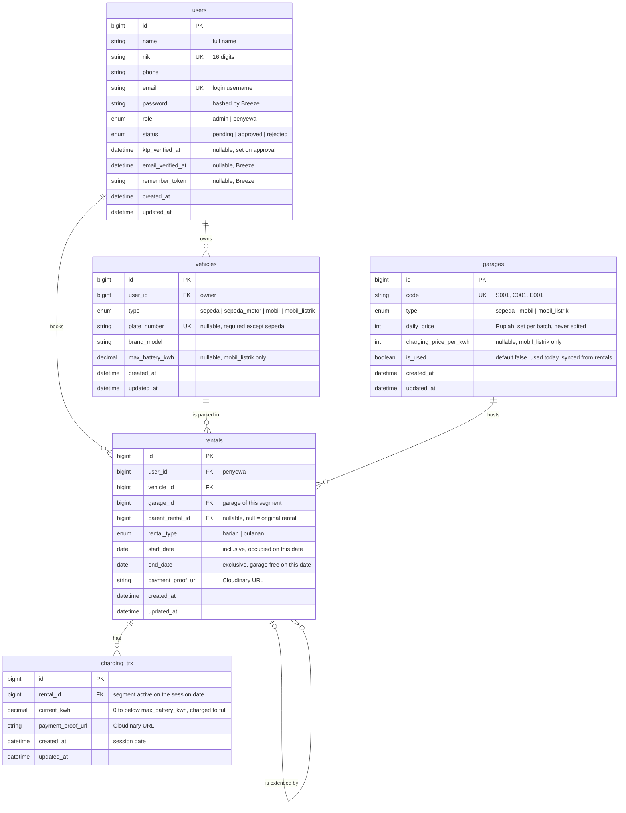

# Garage Rental App — ERD (v1.5, 21 Nov 2026)

Paste **only the code block below** (from `erDiagram` to the last `}`) into https://mermaid.live, or view this file in any Markdown viewer with Mermaid support. If text outside the block is pasted as well, Mermaid draws stray boxes such as "each", "an" or "-".

Changes from v1.4
- `rentals.number_of_days` removed. It is a derived attribute (`end_date − start_date`), so storing it breaks 3NF and risks inconsistent data.
- Enum columns are shown with the `enum` type (users.role, users.status, vehicles.type, garages.type, rentals.rental_type).
- `charging_trx.battery_percent` replaced by `current_kwh`, matching locked requirements §6 (the penyewa enters the current charge in kWh).
- `charging_trx.charging_price` removed, matching locked requirements §8 (totals are not stored on transactions). The cost is computed from the vehicle's capacity and the garage's price, which never change in v1.
- `charging_trx.user_id`, `vehicle_id` and `garage_id` removed, along with their three relationships. They are reachable through `rental_id` (a transitive dependency), so keeping them breaks 3NF in the same way `number_of_days` did.
- `garages.is_used` added because the assignment document requires it. It is a deliberate, controlled denormalization: `rentals` stays the source of truth, and `is_used` is a cached "used today" flag kept in sync by one service (see migration notes).

## Checklist for checking it by hand

| # | Check | Expected |
|---|---|---|
| 1 | Entity count | 5: users, vehicles, garages, rentals, charging_trx |
| 2 | Every FK points to an existing PK | user_id → users.id, vehicle_id → vehicles.id, garage_id → garages.id, rental_id and parent_rental_id → rentals.id |
| 3 | Self-reference on rentals | Original rental: parent_rental_id is null. Extension: parent_rental_id is the original rental's id (always the original, never the previous extension) |
| 4 | Unique columns | users.nik, users.email, vehicles.plate_number (several NULLs allowed for sepeda), garages.code |
| 5 | Nullable columns | users.ktp_verified_at, users.email_verified_at, users.remember_token, vehicles.plate_number, vehicles.max_battery_kwh, garages.charging_price_per_kwh, rentals.parent_rental_id |
| 6 | No days or price on rentals | Days = end_date − start_date. Rent = days × garages.daily_price (harian) or 25 × garages.daily_price (bulanan) |
| 7 | No price or copied FKs on charging_trx | Only rental_id links it. Cost = (rental.vehicle.max_battery_kwh − current_kwh) × rental.garage.charging_price_per_kwh, rounded to whole Rupiah, computed when shown |
| 8 | Availability | A garage is free for [start, end) when no rentals row with that garage_id has start_date < end AND start < end_date |
| 9 | Vehicle check | Same overlap test on rentals.vehicle_id |
| 10 | First E charge | Created in the same DB transaction as the E rental, with the same payment_proof_url |
| 11 | garages.is_used | True exactly when some rentals row with that garage_id has start_date ≤ today < end_date. Never used for availability checks, which always query rentals |

## Cardinality, read aloud

- A user owns zero or many vehicles; each vehicle has exactly one owner.
- A user, vehicle or garage appears in zero or many rentals; each rental row has exactly one of each.
- An original rental has zero or many extensions; an extension has exactly one original (`|o--o{`: the parent is optional because originals have none).
- A rental segment has zero or many charging sessions; each session belongs to exactly one segment. The user, vehicle and garage of a session are read through that segment.

## Migration notes

- Foreign keys: use `->constrained()` with the default restrict on delete. Nothing in v1 deletes users, vehicles, garages or rentals, and a cascade would silently remove revenue.
- `parent_rental_id`: `->nullable()->constrained('rentals')`.
- Enum columns use `$table->enum(...)`. On SQLite, Laravel creates a text column with a CHECK constraint. Cast them to PHP backed enums in the models.
- Money is `unsignedInteger` (whole Rupiah); `max_battery_kwh` and `current_kwh` are `decimal(6, 2)`.
- Number of days and rent are model accessors (`number_of_days` = `start_date->diffInDays(end_date)`), not columns. The form's N input is used only to compute `end_date`.
- Suggested indexes: `rentals(garage_id, start_date, end_date)` and `rentals(vehicle_id, start_date, end_date)` for the overlap checks.
- `charging_trx.rental_id` must point to the segment (original or extension) that covers the session date, so the session uses that segment's garage price. Set it in the service from the active segment, never from form input.
- `garages.is_used`: `$table->boolean('is_used')->default(false)`. Only `GarageStatusService::refresh()` writes it, setting it to whether a rental covers today (WIB). It is called:
  1. inside the DB transaction that saves a rental or extension (a rental that starts today flips the garage to used at once);
  2. by a scheduled command every day at 00:00 Asia/Jakarta, which frees garages whose rental ended and marks garages whose advance booking starts today. In Laravel 11: `Schedule::command('garages:refresh-status')->dailyAt('00:00')->timezone('Asia/Jakarta')` in `routes/console.php`;
  3. by the seeder, and by hand (`php artisan garages:refresh-status`) before the demo.
  On Herd the scheduler only runs while `php artisan schedule:work` is open, so keep it running during the demo.
- Read the related data through Eloquent: `$charging->rental->user`, `->vehicle`, `->garage`. Use `with('rental.garage', 'rental.vehicle')` on lists to avoid N+1 queries.
