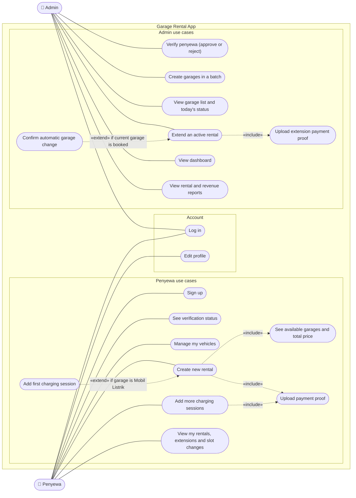

# Garage Rental App — Use Case Diagram (v1.0, 22 Nov 2026)

Paste **only the code block below** (from `flowchart LR` to the last line) into https://mermaid.live, or view this file in any Markdown viewer with Mermaid support. If text outside the block is pasted as well, Mermaid draws stray boxes or fails to parse.

Mermaid has no native use case diagram type, so this uses a flowchart: stick figures become actor boxes, ovals are use cases, and the large frame is the system boundary.

How to read it
- Two main actors: **Admin** (one seeded account) and **Penyewa** (the renter, signs up).
- Solid line: the actor starts this use case.
- `<<include>>` (dashed): the use case always runs the other one as part of itself.
- `<<extend>>` (dashed): the use case runs the other one only under a condition.
- Every use case maps to a route in `routes/web.php` and a rule in `docs/requirements.md`.
- A Penyewa whose status is still pending or rejected can only log in and see the status page, so the rental use cases need the **approved** status.

## Use case descriptions

| # | Actor | Use case | Short description | Rule |
|---|---|---|---|---|
| 1 | Admin, Penyewa | Log in | Email is the username. Admin is a single seeded account | Requirements §1 |
| 2 | Penyewa | Sign up | NIK, name, phone, email, password. NIK and email must be unique, and a rejected NIK cannot sign up again | §3 |
| 3 | Penyewa | See verification status | While pending or rejected, the penyewa sees only the status and cannot rent | §1 |
| 4 | Penyewa | Edit profile | Update own account details | Breeze profile |
| 5 | Penyewa | Manage my vehicles | Create and list vehicles. Plate number is unique (except sepeda), and battery capacity is required for mobil listrik | §2.3 |
| 6 | Penyewa | Create new rental | One rental is one garage and one vehicle, harian or bulanan, with a start date today or later | §4 |
| 7 | Penyewa | See available garages and total price | Only garages free for the whole range [start, end) are listed, each with its own price, and the total is shown before saving | §4 |
| 8 | Penyewa | Upload payment proof | An image stored on Cloudinary. The rental is active as soon as it is saved | §4, §9 |
| 9 | Penyewa | Add first charging session | Required only when the garage is Mobil Listrik. Saved together with the rental | §4, §6 |
| 10 | Penyewa | Add more charging sessions | Allowed while the rental is active on an E garage, with a new payment proof each time | §6 |
| 11 | Penyewa | View my rentals | Read-only list of rentals, extensions, slot change notices and charging sessions | §7 |
| 12 | Admin | Verify penyewa | Check the KTP manually, then approve or reject | §3 |
| 13 | Admin | Create garages in a batch | Type, amount, daily price (and charging price for Mobil Listrik). Codes are generated as S001, C001, E001, up to 999 per type | §2.2 |
| 14 | Admin | View garage list | Read-only, with today's status and each garage's price | §8 |
| 15 | Admin | Extend an active rental | Pick a garage that is active today, choose harian or bulanan, and the new end date is filled in. Extension only, no shortening | §5 |
| 16 | Admin | Confirm automatic garage change | If the current garage is booked by someone else, the cheapest free garage of the same type is proposed, and the admin confirms or cancels. If none is free, the extension is blocked | §5 |
| 17 | Admin | Upload extension payment proof | The admin, not the penyewa, uploads the proof for an extension | §5, §9 |
| 18 | Admin | View dashboard | Total revenue, total penyewa, and today's used or free status of every slot by type | §8 |
| 19 | Admin | View reports | Rentals and revenue per month, per day, per garage type, and per penyewa, on screen only | §8 |

## Notes for the report

- The two actors do not share business use cases: only the penyewa can create rentals, and only the admin can extend them (the admin cannot create new rentals).
- "Log in" is the only use case both actors share.
- Scheduled status refresh (`garages:refresh-status` at 00:00 Asia/Jakarta) is not shown because it is run by the scheduler, not by a person. It can be added as a third, system actor if the assessor asks.
